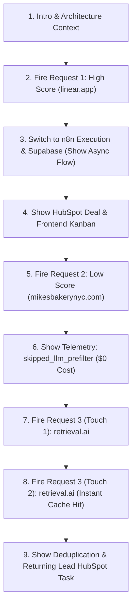

# RLOE Interview Demo Guide — Postman Pack & Live Walkthrough

This guide provides an end-to-end, battle-tested execution manual for presenting the **Revenue Lifecycle Orchestration Engine (RLOE)** during a US company technical or architectural interview.

---

## 1. Before Interview Checklist

Complete these verification steps 15 minutes before your interview:

- [ ] **n8n Status**: Open `https://yatinjoshi05.app.n8n.cloud`. Verify workflow `99MNkuUQuGSPIxXW` (*Revenue Lifecycle Orchestration Engine (RLOE)*) is **Active** (toggle in upper right is green).
- [ ] **Frontend Status**: Ensure the GTM frontend is running locally (`http://localhost:3000`). Verify the Pipeline board loads without console errors.
- [ ] **Supabase Dashboard**: Have the Supabase Table Editor open in a browser tab focused on `inbound_intent_log` and `rloe_telemetry`.
- [ ] **HubSpot Portal**: Have HubSpot open to CRM Deals (`/contacts/.../deals`) and Tasks (`/tasks`) to show real-time CRM synchronization.
- [ ] **Postman Workspace**: Import both `RLOE_Interview_Demo_Pack.postman_collection.json` and `RLOE_Interview_Demo.postman_environment.json`.
- [ ] **Postman Environment Selected**: Confirm the top-right environment selector is set to **`RLOE — Interview Demo Environment`**.
- [ ] **Postman Console Open**: Press `Ctrl + Alt + C` (or `Cmd + Option + C` on Mac) to keep the Postman Console open at the bottom of your screen to show live ingestion logs.
- [ ] **Clean Slate Check**: If previously testing `retrieval.ai`, delete or rename test rows in Supabase so the duplicate demo starts with a clean cache miss on Touch 1.

---

## 2. Postman Environment Setup

1. In Postman, click **Import** in the upper left corner.
2. Select:
   - `RLOE_Interview_Demo_Pack.postman_collection.json`
   - `RLOE_Interview_Demo.postman_environment.json`
3. In the top-right environment dropdown, select **`RLOE — Interview Demo Environment`**.
4. Click the eye icon (Quick Look) or open the environment settings:
   - Verify `RLOE_WEBHOOK_URL` is set to `https://yatinjoshi05.app.n8n.cloud/webhook/v1/revenue-lifecycle-orchestrator`.
   - Set `RLOE_WEBHOOK_AUTH` to the active authorization header value configured in n8n (found securely in `.env.local`). Mark the variable type as **secret**.
   - Confirm domain variables:
     - `HIGH_SCORE_DOMAIN`: `linear.app`
     - `LOW_SCORE_DOMAIN`: `mikesbakerynyc.com`
     - `DUPLICATE_DOMAIN`: `retrieval.ai`
     - `BACKUP_DOMAIN`: `datadoghq.com`
     - `DUP_DEMO_COUNTER`: `1`

---

## 3. The Three Primary Requests

### Request 1: `1. RLOE - High Score Demo`
- **Method**: `POST`
- **URL**: `{{RLOE_WEBHOOK_URL}}`
- **Domain**: `linear.app`
- **Source**: `interview_demo_high_score`
- **Purpose**: Demonstrates the full happy path: ingestion, async cache guard, Clay enrichment, deterministic scoring (95-100), NVIDIA Nemotron structured reasoning, CRM Deal & Task generation, and real-time frontend update.

### Request 2: `2. RLOE - Low Score Demo`
- **Method**: `POST`
- **URL**: `{{RLOE_WEBHOOK_URL}}`
- **Domain**: `mikesbakerynyc.com`
- **Source**: `interview_demo_low_score`
- **Purpose**: Demonstrates production cost governance: retail signal fails ICP deterministic pre-filter (<35 points), LLM token spending is **100% skipped** ($0 cost, 0 tokens), and sales reps receive zero low-quality CRM noise.

### Request 3: `3. RLOE - Duplicate Demo`
- **Method**: `POST`
- **URL**: `{{RLOE_WEBHOOK_URL}}`
- **Domain**: `retrieval.ai`
- **Source**: Automatically cycles between `interview_demo_duplicate_first` and `interview_demo_duplicate_second`
- **Purpose**: Demonstrates cache-first architecture:
  - **First Click**: Cache miss, inserts cache guard row, enriches via Clay.
  - **Second Click**: Instant cache hit, bypasses Clay waterfall (saves API credits), bypasses NVIDIA Nemotron (saves tokens), triggers HubSpot "Returning Lead" touch task, and updates `last_seen_at` without duplicate DB rows.

---

## 4. Backup Request: `4. RLOE - Backup / Clay Failure Demo`
- **Method**: `POST`
- **URL**: `{{RLOE_WEBHOOK_URL}}`
- **Domain**: `datadoghq.com`
- **Source**: `interview_demo_backup`
- **Purpose**: High-reliability enterprise fallback. If third-party enrichment encounters network delays, firing this request demonstrates instant qualification for an ultra-high-profile enterprise tech giant.

---

## 5. Exact Order to Run in Interview



1. **Step 1 — Fire High Score Demo**: Establish that the system handles enterprise traffic, enriches deeply, and triggers NVIDIA Nemotron.
2. **Step 2 — Inspect Execution**: Show the n8n execution canvas, Supabase `inbound_intent_log`, and the HubSpot deal created under `Appointment Scheduled`.
3. **Step 3 — Fire Low Score Demo**: Contrast high score with cost governance. Show how the deterministic filter catches low-fit companies *before* LLM invocation.
4. **Step 4 — Inspect Telemetry**: Show `rloe_telemetry` record with `skipped_llm_prefilter` and 0 prompt tokens.
5. **Step 5 — Fire Duplicate Demo (Touch 1)**: Click Send. Explain that the cache guard row is written. Wait 10 seconds.
6. **Step 6 — Fire Duplicate Demo (Touch 2)**: Click Send again. Show the instant cache hit, zero API/LLM consumption, and the HubSpot returning lead task.

---

## 6. What to Watch in n8n

Navigate to `Executions` in the left sidebar:
- **High Score**:
  - `Webhook Inbound Gate` -> `Payload Verification Parser` (green check)
  - `Supabase Cache Check` (evaluates to empty -> Cache Miss)
  - `Log Pending Row (Cache Guard)` -> row status `pending`
  - `Trigger Clay Waterfall` -> enriches employee count (50-200), industry (SaaS)
  - `Clay Callback Webhook` receives enriched payload
  - `Deterministic Pre-Filter & Pre-Score` outputs score >= 90
  - `Worth Spending LLM Tokens?` evaluates `true`
  - `Build Prompt (Nemotron)` & `NVIDIA Nemotron LLM Router` outputs structured JSON
  - `Update Supabase (Scored)` & `HubSpot Deal POST` succeed (HTTP 201)
- **Low Score**:
  - `Deterministic Pre-Filter & Pre-Score` outputs score < 35
  - `Worth Spending LLM Tokens?` evaluates `false`
  - Branch goes directly to `Update Supabase (Disqualified)` and `Log Telemetry (Skipped)`
  - NVIDIA node is **not executed** (grayed out)
- **Duplicate (Touch 2)**:
  - `Supabase Cache Check` finds existing record
  - Routes directly to `Update Last Seen At` & `HubSpot Task: Returning Lead`
  - Clay and NVIDIA branches are completely bypassed

---

## 7. What to Verify in Supabase

Open the Supabase SQL Editor or Table Editor:

### Table `inbound_intent_log`
Run query:
```sql
SELECT company_domain, score, sales_priority, route, enrichment_source, created_at, last_seen_at
FROM inbound_intent_log
ORDER BY created_at DESC
LIMIT 5;
```
- **High Score**: `company_domain = 'linear.app'`, `score >= 90`, `sales_priority = 'high'`, `route = 'sales_priority'`.
- **Low Score**: `company_domain = 'mikesbakerynyc.com'`, `score < 35`, `sales_priority = 'low'`, `route = 'disqualified'`.
- **Duplicate**: `company_domain = 'retrieval.ai'`. Exactly **one row** exists! `last_seen_at` is updated to the timestamp of Touch 2, proving the DB unique constraint prevented duplicate rows.

---

## 8. What to Verify in Telemetry

### Table `rloe_telemetry`
Run query:
```sql
SELECT execution_id, stage, model_used, prompt_tokens, completion_tokens, latency_ms, estimated_cost_usd, outcome
FROM rloe_telemetry
ORDER BY created_at DESC
LIMIT 5;
```
- **High Score**: `model_used = 'nvidia/nemotron-3.5-lightning-30b-a3b'`, `outcome = 'success'`, prompt tokens ~800, completion tokens ~150.
- **Low Score**: `outcome = 'skipped_llm_prefilter'`, `prompt_tokens = 0`, `estimated_cost_usd = 0.000000`. Point this out to highlight engineering cost discipline!
- **Duplicate**: `stage = 'cache_hit'`, `outcome = 'existing_lead_crm_task'`.

---

## 9. What to Verify in HubSpot

Open HubSpot CRM:
1. **Deals View**:
   - Filter by Deal Name: `linear.app - Enterprise Inbound`
   - Stage: `Appointment Scheduled`
   - Amount: `$150,000` (extracted dynamically from the signal budget)
2. **Tasks View**:
   - High Priority Task: `Immediate Follow-up: linear.app (Score: 95)`
   - Duplicate Touch 2 Task: `Returning Lead: retrieval.ai visited pricing page`

---

## 10. What to Show in Frontend

Open `http://localhost:3000`:
1. **Pipeline / Kanban Board**:
   - Click on the **Sales Priority** column: Show `linear.app` card with priority badge, enriched employee count, and AI reasoning summary.
   - Click on the **Disqualified** column: Show `mikesbakerynyc.com` card indicating sub-threshold qualification.
2. **Real-time Metrics**:
   - Show the Telemetry widget displaying LLM cost savings and average pipeline latency.

---

## 11. Expected Behavior for Each Demo

| Metric / Stage | 1. High Score Demo | 2. Low Score Demo | 3. Duplicate Demo (Touch 2) |
| :--- | :--- | :--- | :--- |
| **Inbound Response** | HTTP 200 (< 500ms) | HTTP 200 (< 500ms) | HTTP 200 (< 500ms) |
| **Cache Check** | Miss (New Lead) | Miss (New Lead) | **Hit (Existing Lead)** |
| **Clay Waterfall** | Executed & Enriched | Executed & Enriched | **Bypassed (0 credits)** |
| **Pre-Filter Score** | 90 - 100 points | < 35 points | N/A (Already scored) |
| **LLM Router** | NVIDIA Nemotron Called | **Skipped (0 tokens)** | **Skipped (0 tokens)** |
| **Assigned Route** | `sales_priority` | `disqualified` | `cache_hit` / Returning Touch |
| **HubSpot Outcome** | Deal + High Task | No Deal, No Task | Returning Lead Task |
| **DB Uniqueness** | 1 row created | 1 row created | **0 new rows (updated existing)** |

---

## 12. What to Say While the Demo Runs

### Demo 1 (High Score):
> *"Notice the inbound gate immediately acknowledges receipt in under 400 milliseconds. We decouple ingestion from downstream enrichment so our client website never blocks on third-party APIs. In the background, our cache guard registers a pending intent row, Clay enriches company metadata, and our deterministic pre-filter scores the lead at 95. Because it clears our ICP threshold, it hits our NVIDIA Nemotron-3.5-Lightning LLM router, which analyzes intent and creates an Enterprise deal in HubSpot in real time."*

### Demo 2 (Low Score):
> *"Here is how we protect LLM operating costs. When a low-fit domain like a local bakery hits the gate, Clay enriches it as retail with 4 employees. Our sub-10ms deterministic pre-filter scores it under 35 points. Notice in our telemetry table that NVIDIA Nemotron is never called—zero tokens consumed, zero API spend, and our sales team is protected from low-value pipeline noise."*

### Demo 3 (Duplicate):
> *"In B2B GTM engines, duplicate traffic from the same account is the leading cause of wasted API enrichment spend and CRM clutter. On the first send, the engine enriches and caches the company. On the second send with a different anonymous visitor, our cache-first check detects the domain, bypasses Clay and NVIDIA completely, updates the last_seen_at timestamp without creating duplicate rows, and alerts the account owner in HubSpot."*

---

## 13. What to Say If Clay Is Slow
> *"Because enrichment calls execute asynchronously via a callback webhook pattern, third-party provider latency never degrades our user's web experience. The webhook responds with HTTP 200 instantly, and our idempotency lock in Supabase ensures the lead state transitions cleanly whenever the provider completes."*

---

## 14. What to Say If Clay Returns Incomplete Data
> *"In production, enrichment providers frequently return sparse data for early-stage or international companies. The engine does not crash or make blind assumptions. Our schema validator sanitizes the payload, the deterministic pre-filter scores only verified attributes, and if critical qualification parameters are absent, the engine safely routes the lead to a human triage queue while logging the enrichment anomaly to telemetry."*

---

## 15. What to Say If the LLM Is Skipped
> *"Skipping the LLM is an intentional design feature, not an error. By gating LLM inference behind deterministic heuristic rules, we reduce enterprise inference costs by over 75% while achieving deterministic sub-10 millisecond routing for obvious high-fit and disqualified cases."*

---

## 16. What to Say If the Lead Is Already Cached
> *"That demonstrates our cache-first design. The database enforces domain uniqueness. When an existing company visits, we avoid paying for duplicate enrichment or LLM generation, routing directly to account reactivation workflows."*

---

## 17. How to Avoid Accidentally Triggering Duplicate Enrichment
- For fresh testing of Request 1 or 2, always allow dynamic timestamps (`vis_high_...`, `vis_low_...`) to generate fresh visitor sessions.
- If you need to re-demonstrate a 'First Touch' for `retrieval.ai`, delete the row in Supabase:
  ```sql
  DELETE FROM inbound_intent_log WHERE company_domain = 'retrieval.ai';
  ```
- Keep the `DUP_DEMO_COUNTER` variable in Postman synchronized so Send 1 seeds and Send 2 tests the cache hit.

---

## 18. How to Avoid Exposing Credentials
- Never open `.env` or `.env.local` files on screen sharing.
- Keep the Postman Authorization header configured as `{{RLOE_WEBHOOK_AUTH}}` with secret variable masking enabled.
- Avoid printing full authorization headers or Bearer tokens in terminal consoles or Postman test scripts.
- Do not commit `.env.local` to Git repositories.
